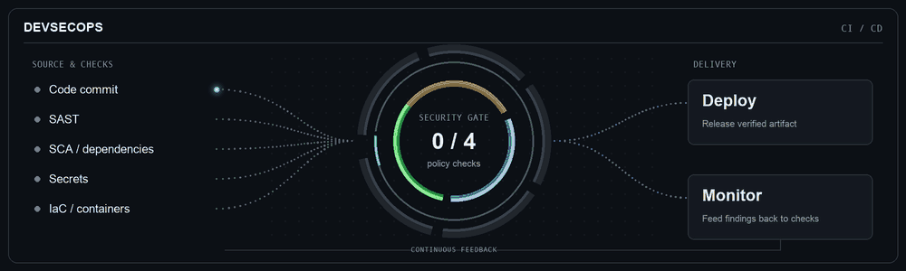

### Hello 👋

- 💻 DevOps & SRE Architect (ex-Network Engineer) with a security-first mindset.
- ❤️ Builder at heart: tinkering with custom PC builds, automotive projects, DIY furniture, and solar power systems.
- 🏭 If it’s repetitive, I automate it.

[Static version](assets/devsecops-pipeline.png)
